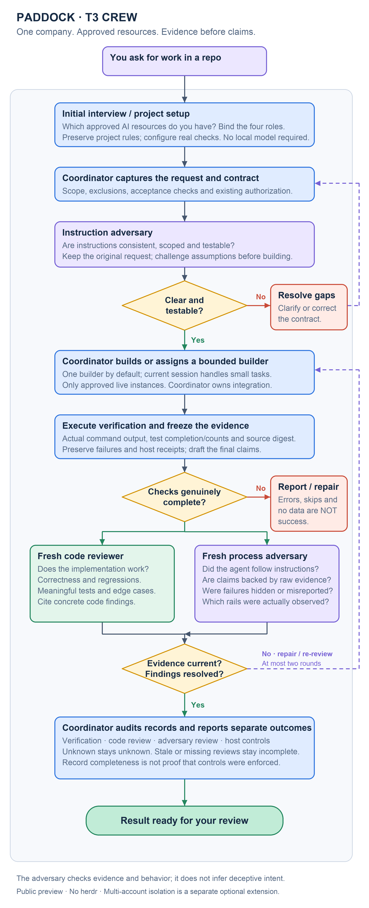

# Paddock

Paddock gives your AI coding assistant a dependable way of working. In T3 Code, with
Claude or ChatGPT/Codex, it agrees what "done" means before starting, runs your
project's real tests, gets the work checked by separate reviewers, and reports honestly
what passed, what failed and what it couldn't check.

It's for individuals and teams who want AI-written changes they can trust without
watching every step. One approved AI account is enough. No local model, extra service or
account juggling is needed.

**Status:** public preview, version 0.2.0. Tested on macOS, Linux and Windows in CI; see
[what has and hasn't been verified](t3/VALIDATION.md).

## What you get

- **Real checks, not claims.** A task counts as verified only when your project's actual
  tests ran and passed. Skipped tests, no tests, timeouts and "exit code 0" don't count.
- **Independent reviews.** A fresh code reviewer and a separate process reviewer check the
  work in their own sessions. The process reviewer looks for claims the evidence doesn't
  support, missing results and ignored instructions.
- **Honest reports.** Checks, each review and anything unknown are reported separately.
  Gaps stay marked as gaps.
- **Exposed credentials stop the work.** If a password, API key or token shows up in chat,
  files or output, the assistant stops, never repeats it, and helps you revoke and replace
  it. Work continues only once the rotation is confirmed.
  [How this works](t3/skills/paddock-crew/references/secrets.md)
- **Your project stays yours.** Existing instructions and tests are kept. Paddock adds a
  small `.paddock` folder and never publishes, deploys or changes credentials on its own.



## Install

You need [T3 Code](https://t3.codes/download) signed in to Claude or ChatGPT/Codex,
[Python](https://www.python.org/downloads/) 3.11 or newer, and
[Git](https://git-scm.com/install/). New to all of this? Follow the step-by-step
[setup guide](t3/SETUP-GUIDE.md) instead.

**Windows (PowerShell):**

```powershell
git clone https://github.com/jkomg/paddock
cd paddock
python t3/install.py --skills-dir "$HOME/.codex/skills"          # preview
python t3/install.py --skills-dir "$HOME/.codex/skills" --apply  # install
```

**macOS or Linux:**

```sh
git clone https://github.com/jkomg/paddock
cd paddock
python3 t3/install.py --skills-dir "$HOME/.codex/skills"          # preview
python3 t3/install.py --skills-dir "$HOME/.codex/skills" --apply  # install
```

For Claude, use `$HOME/.claude/skills` instead. If T3's provider settings show a custom
Codex or Claude home folder, use the `skills` folder inside it. The installer changes
nothing outside that folder and needs no administrator rights or extra packages.

## First use

Start a **new** session in T3, open your project, and paste:

> Use Paddock Crew to set up this project. Interview me about my approved Claude,
> ChatGPT/Codex, Gemini, LiteLLM or Cursor access. Keep local models off. Discover T3's
> actual providers, map the four roles to approved instances, preserve this project's
> existing instructions and tests, and establish the verification command. Keep the
> process reviewer separate from code review. Do not publish or deploy anything.

Then give it a small real task. The setup guide has
[a practice task](t3/SETUP-GUIDE.md#8-complete-your-first-checked-task) you can paste.

## Update or remove

```sh
git pull
python3 t3/install.py --skills-dir "$HOME/.codex/skills" --upgrade --apply
python3 t3/install.py --skills-dir "$HOME/.codex/skills" --uninstall --apply
```

Use `python` on Windows. Leave off `--apply` to preview first. Removing the skill doesn't
touch your projects.

## More

- [Setup guide](t3/SETUP-GUIDE.md): Windows and Mac, step by step, for first-time users
- [Quickstart](t3/QUICKSTART.md): the short reference, the CLI and sharing the installer ZIP
- [Validation record](t3/VALIDATION.md): what has and hasn't actually been tested
- [Changelog](t3/CHANGELOG.md)
- Building release ZIPs: `python3 scripts/build_release.py`, then
  `python3 scripts/check_release.py --test dist/*.zip`

**Limits:** Paddock's records are local files, not tamper-proof attestations, and a
complete audit isn't proof the code is correct. Spotting a credential pasted into chat is
the assistant's job; nothing intercepts a message before the model reads it.

**Multiple accounts?** Paddock's original tools lock each folder to the right account
when you use several logins (for example two employers). They're separate from the T3
crew; see [multi-account guards and the herdr crew](docs/legacy-multi-account.md).

## License

MIT. See [LICENSE](LICENSE).
